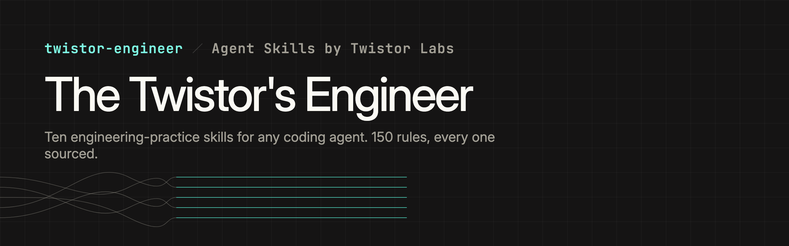
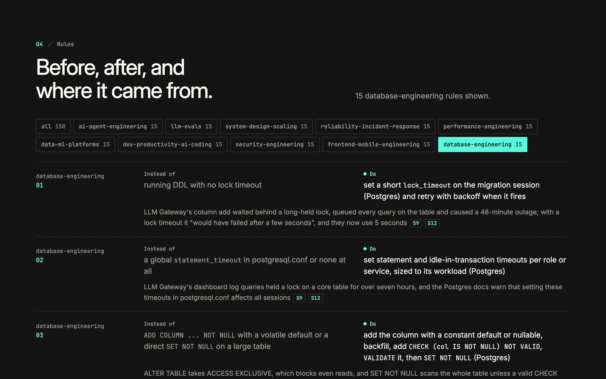
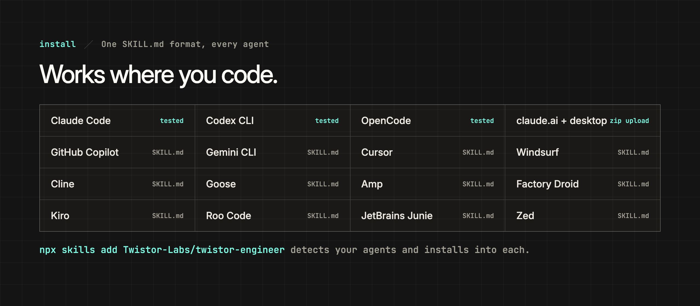
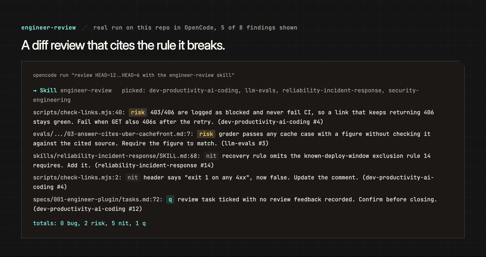

<p align="center"></p>

<p align="center">
  <a href="https://engineer.twistorlabs.com">Site</a> ·
  <a href="#install">Install</a> ·
  <a href="#skills">Skills</a> ·
  <a href="https://github.com/Twistor-Labs/twistor-engineer/releases/latest">Releases</a> ·
  <a href="LICENSE">MIT</a>
</p>

Engineering-practice skills for coding agents. Each skill is a short list of rules in the form
"instead of X, do Y", and every figure in a rule links to the public engineering post it came
from: Anthropic, Cloudflare, Netflix, Meta, Uber, Discord, Airbnb, LinkedIn, Zepto and others.

They use the open Agent Skills format (`SKILL.md`), so they work in Claude Code, Codex, Cursor,
GitHub Copilot, Gemini CLI, OpenCode and every other agent that reads it.

<p align="center"></p>

## Install

**Any agent, one command.** Detects the agents on your machine and installs into each:

```
npx skills add Twistor-Labs/twistor-engineer
```

Add `-a <agent>` to pick one (`claude-code`, `codex`, `cursor`, `github-copilot`, `gemini-cli`,
`opencode`, `windsurf`, `cline`, `goose`, `amp`, `droid`, `roo`, `kiro`, `zed`), `-g` for your
user folder instead of the project, or `--skill <name>` for a single skill.

| Where you work | How |
|---|---|
| **Claude Code** (CLI, desktop, IDE) | `/plugin marketplace add Twistor-Labs/twistor-engineer` then `/plugin install twistor-engineer@twistor-engineer`. Includes the `engineer-reviewer` subagent. |
| **claude.ai and Claude desktop app** | Download a skill zip from [Releases](https://github.com/Twistor-Labs/twistor-engineer/releases/latest), then Customize > Skills > upload. One zip per skill. |
| **Codex** (CLI, IDE, app) | `codex plugin marketplace add Twistor-Labs/twistor-engineer`, or `npx skills add Twistor-Labs/twistor-engineer -a codex` |
| **GitHub Copilot** (CLI, VS Code) | `npx skills add Twistor-Labs/twistor-engineer -a github-copilot` |
| **Gemini CLI** | `npx skills add Twistor-Labs/twistor-engineer -a gemini-cli` |
| **Cursor** | `npx skills add Twistor-Labs/twistor-engineer -a cursor` |
| **OpenCode** | `npx skills add Twistor-Labs/twistor-engineer -a opencode` |
| **Anything else** | Copy `plugins/twistor-engineer/skills/*` into your agent's skills folder (`~/.agents/skills/` is read by most). |

<p align="center"></p>

We test every release in Claude Code, Codex and OpenCode. The others read the same `SKILL.md`
format per their own docs.

## Try it

Skills load on their own when your question matches. Ask your agent something real:

- "Our p99 doubled after moving the Go service to Kubernetes with a 2 CPU limit. Why?"
- "We push a generated rate-limit config to 40 regions in 30 seconds. What should change first?"
- "Should our support bot be one agent with tools or a planner plus subagents?"

Then try the workflow skills on your own repo:

- **engineer-review**: "review my branch with engineer-review". One line per finding, tagged
  bug, risk, nit or question, each citing the rule it breaks.
- **engineer-postmortem**: paste incident notes and ask for a postmortem. You get a UTC timeline,
  root causes, the closest public outage and action items with owners and revisit triggers.
- **engineer-design-review**: point it at a design doc or RFC before you build. Findings name the
  doc section and the rule, then the open questions that block a go/no-go.
- **engineer-security-audit**: "audit this repo for security". Every candidate goes to a fresh
  verifier that tries to disprove it, so you get confirmed findings, not scanner noise.

<p align="center"></p>

If you run many plugins and a skill doesn't load, call it by name, for example
`/twistor-engineer:system-design-scaling` in Claude Code or `$system-design-scaling` in Codex.

## Skills

| Skill | Use it for |
|---|---|
| `ai-agent-engineering` | Workflow vs agent, tool design, context budgets, multi-agent, long-running harnesses |
| `llm-evals` | Eval sets from real failures, code and model graders, pass@k vs pass^k, production quality checks |
| `system-design-scaling` | Capacity math, where it breaks first, data store choice, caches, cells |
| `reliability-incident-response` | Staged rollouts, config as code, kill switches, mitigation ladder, postmortems |
| `performance-engineering` | Tail latency, profiling, GC and runtime traps, LLM inference benchmarking |
| `data-ml-platforms` | Data contracts, online/offline parity, orchestration and backfill, experiment metrics |
| `dev-productivity-ai-coding` | Agentic coding workflow, review at agent volume, CI cost, LLM-driven migrations |
| `security-engineering` | Sandboxing agents, credentials outside the box, scoped tools, approval tiers |
| `frontend-mobile-engineering` | Performance budgets, safe mobile releases and OTA, server-driven UI, startup-scale lessons |
| `database-engineering` | Online schema changes, lock and statement timeouts, backfills, expand and contract, cutovers, connection pools, restore drills |
| `engineer-review` | Diff review against the checklists above |
| `engineer-design-review` | Design doc or RFC review before code exists |
| `engineer-security-audit` | Whole-repo security audit with adversarial verification and a free-scanner map |
| `engineer-postmortem` | Incident notes to a blameless postmortem |

Each practice skill has the same shape: when to use it, 15 rules, the shape of a good answer, red
flags, how to verify, and a `references/` folder with case studies, a checklist and `sources.md`.

## Does it help?

We asked 18 realistic questions, two per skill, once with the skill and once without, and graded
every answer against 73 written criteria. With the skill, answers met 71 of them; without, 56. The skill won 13
questions, tied 5 and lost none, at about 6% more tokens per answer. Most of the gap is sourced
specifics, such as a named outage's cause or a company's measured figure.

The three v1.2 skills were run the same way in November 2026 on 4 more questions and 28 criteria:
28 with the skill, 19 without. database-engineering 12 vs 8, engineer-design-review 8 vs 3,
engineer-security-audit 8 vs 8. The audit fixture is too easy for now: the plain model found every
planted bug too.

## Sources

Every rule cites its sources by id (`[S3]`). Each id points to a line in that skill's
`references/sources.md` with the URL, the date and a status: VERIFIED, CORRECTED (the number most
people repeat is wrong, so we use the fixed one) or PRESS-SOURCED. Numbers a company reports about
itself are written as that company's claim.

Company names identify the public posts we cite. Twistor Labs is not affiliated with or endorsed
by any of them.

## License

MIT. Copyright 2026 Twistor Labs Private Limited.
